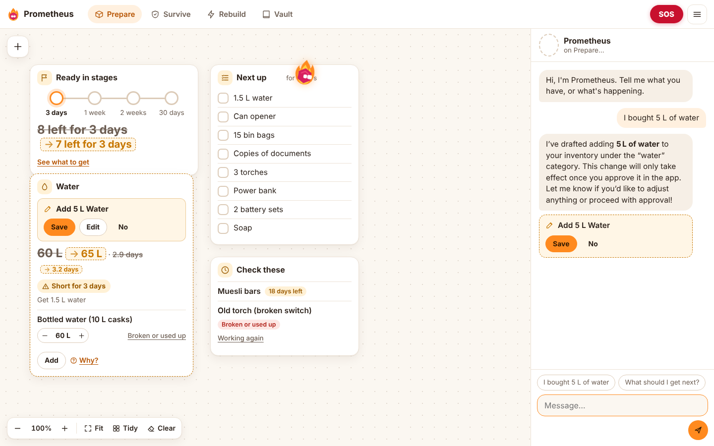

# Project Prometheus — Humanity's Backup Brain

> **Prepare today. Survive tomorrow. Rebuild the future.**

Prometheus is a persistent, resource-aware **AI apocalypse buddy**. It is one continuous companion that knows your household, tracks your supplies, helps you through an emergency, and teaches you the science needed to rebuild. It runs on **NVIDIA Nemotron** through **Nebius Token Factory**.

Built for the **Nebius × NVIDIA Global AI Hackathon, Personal AI track**.

**Live demo:** https://project-prometheus-tp0i.onrender.com (free hosting, so the first load after a quiet spell can take a minute). Open **≡ → Try the demo family** (Simple mode) or **Settings → Load demo household** (Advanced mode) to try it.

The companion is the heart of the app. The survival kit calculator, inventory, knowledge vault and technology tree are all **real tools** it calls against your saved data.

### Two looks, one companion
- **Simple mode** (`/`) is for normal people. It's a calm canvas of cards beside the chat, in a warm light look, with the original dark look one tap away. Tell Prometheus "I bought 5 L of water" and the flame flies out of the chat to the Water card, pencils in **60 L → 65 L** and waits for **Save**. Readiness is shown in stages (3 days → 1 week → 2 weeks → your goal) with a short **Next up** list, not a percentage. A red **SOS** button opens a full-screen emergency flow that works without AI, even offline.
- **Advanced mode** (`advanced.html`) is the full workspace: every table, the tool call log and **Under the hood**. Switch from **≡ → Advanced mode** or **Settings → Simple mode**. **≡ → Show me how it works** opens it with Under the hood on.



---

## What it does

| Mode | What you get |
|---|---|
| **Prepare** | A household profile (people, pets, medication, 3/7/14/30-day plan). Deterministic supply targets computed from cited guidelines. An editable inventory with expiry and working/unavailable status. Shortage detection, and restock tasks that Prometheus proposes and **you approve**. |
| **Survive** | Scenario guides (extended blackout is fully worked; supply disruption, isolation, and a clearly labelled *fictional* zombie drill). Each guide has triage questions, your household's real resource picture (days of water and food, lighting, radio), source-backed steps, and a saved, checkable response plan. |
| **Rebuild** | An interactive, validated **electricity technology tree** (12 nodes, from *Energy & power* to *Small off-grid DC power*). It shows prerequisites, learning paths, materials you have or lack, safety level and sources. The companion opens nodes and explains them. |
| **Knowledge Vault** | 20 curated, offline entries on preparedness, water, food, shelter, first aid, energy and science, with linked sources (Australian Red Cross, WA DFES / Emergency WA, Ready.gov, CDC, FoodSafety.gov, OpenStax, PhET and others). |
| **Companion** | Nemotron with 16 validated tools, persistent memory, conversation restore, and an **Under the hood** view showing the real model ID, response ID, latency, token usage, and every tool call with its arguments and effect. In Simple mode it also drives the canvas: each tool says which card it's about, and the app places the card. |

### How Prometheus stays honest
- **Real tool calling.** Every tool reads or writes the SQLite database. Read tools run automatically.
- **You approve changes.** Tools that would change data (`update_household_profile`, `add_inventory_item`, `update_inventory_item`, `propose_restock_tasks`, `create_survival_plan`) only create a *pending action*. State changes only when you click **Approve** (`POST /api/actions/{id}/approve`).
- **No invented numbers.** Supply targets and shortfalls come from `backend/app/prepare/` and `data/assumptions.json`, never from the model. Food is counted in **kcal / meal-equivalents, not cans**.
- **No invented citations.** The model can only cite sources returned by `search_knowledge` / `get_scenario_guide`, and survival-plan steps with unknown knowledge IDs are rejected by validation. Optional live web search (`web_search`, via Tavily) only searches the sites in the source registry, and any result from another site is dropped.
- **Previews are computed, not imagined.** A pencil value (60 L → 65 L) comes from `GET /api/actions/{id}/preview`, which runs the calculator on a copy of your data and saves nothing. You can **Edit** a proposal before saving it, and **Undo** any saved change.
- **Permission modes, like Claude Code.** *Ask first* (default) proposes everything. *Auto* saves only small supply changes, and only when the amount is in your own message ("I bought 5 L" saves; "I bought a slab" asks). Household and plan changes always ask, and every automatic save is listed under **What changed** with Undo. *Plan* only drafts, then offers **Save all**.
- **"Coverage of planning targets"**, never a survival probability.
- **AI guesses are never confirmed facts.** Notes Prometheus saves are marked *suggested* until you confirm them (Settings → Memory).
- **No fake AI.** Without a key, chat shows an honest "unavailable" state and every data view still works offline. Tests use a scripted fake client to test the orchestration code; they never claim to be Nemotron.

---

## Architecture

```
frontend/  (vanilla HTML/CSS/JS, no build step)
   ├── index.html + simple.css + js/simple/   Simple mode: canvas engine, cards, chat, flame, permission modes, SOS
   ├── advanced.html + styles.css + js/app.js Advanced mode (the original workspace)
   └── sw.js + manifest.webmanifest           offline cache (network first) and install
   │  fetch /api/*
backend/app/main.py  FastAPI ── cookie → household id (one isolated household per browser)
   ├── agent/llm.py       httpx → https://api.tokenfactory.nebius.com/v1/chat/completions  (OpenAI-compatible tools)
   ├── agent/loop.py      model → validate tool calls → execute → feed results → final answer (bounded rounds)
   ├── agent/tools.py     16 tools: Pydantic-validated args, read / propose / note kinds, approval executors,
   │                      card hints for Simple mode, previews, edit, undo and the Auto-mode rules
   ├── agent/persona.py   Prometheus personality + per-turn household context snapshot
   ├── prepare/           deterministic calculator + readiness/shortages/restock drafts + readiness in stages
   ├── survive/           scenario guides + household situation analysis
   ├── knowledge/         offline BM25 search over data/knowledge.json + data/sources.json
   ├── rebuild/           tech-tree DAG loader/validator (acyclic, safety prerequisites), learning paths
   └── db.py              SQLite: households, memory_notes, inventory, tasks, pending_actions,
                          messages, plans, tool_log, usage (rate limiting)
data/      assumptions.json · knowledge.json · sources.json · scenarios.json · techtree/electricity.json
```

**Connected mode:** Nemotron via Nebius Token Factory runs the full agent and tool workflow.
**Offline data mode:** inventory, readiness, tasks, plans, knowledge vault and tech tree all work without AI or internet (the app server runs locally).
**Local AI mode (planned):** optional llama.cpp + GGUF model behind the same `ChatClient` interface. This isn't implemented yet.

The header chip always says which mode is active. It only shows **"Cloud AI live"** after a real reply, and it names the model the API reported back.

---

## Run it on Windows

Requires Python 3.11+ (`py --version`).

```powershell
git clone https://github.com/Ponti23/project-prometheus.git
cd project-prometheus
py -m venv .venv
.\.venv\Scripts\activate
pip install -r requirements.txt
copy .env.example .env        # then edit .env and set NEBIUS_API_KEY
python scripts\verify_nebius.py   # lists Nemotron models + runs a real tool-calling probe
uvicorn backend.app.main:app --port 8000
```

Open http://localhost:8000. Or run `.\run.ps1`, which does the same steps.

macOS/Linux: the same commands with `python3 -m venv .venv`, `source .venv/bin/activate` and `cp`.

**No key yet?** The app still runs: chat shows "Cloud AI unavailable", and everything else works. Click **Load demo household** to explore with synthetic data.

### Tests

```powershell
python -m pytest -q                              # unit + API tests (no network)
python -m pytest tests/test_nebius_live.py -v -s # LIVE Nemotron tests (needs NEBIUS_API_KEY)
```

The tests cover the calculator (the 5-person / 30-day regression), readiness (units, expiry, unavailable items, kcal vs cans, recalculation), tools (schemas, validation, *propose never mutates before approval*, citation validation), the agent loop (multi-round tool use, malformed tool calls, bounded rounds, rate limiting, provider failure surfaced not faked), the tech tree (acyclic, safety prerequisites, learning order) and the API (cookie isolation, approval flow, persistence across restart). Simple mode adds tests for readiness in stages against the demo household, card hints, previews, editing a proposal, the permission modes (the number check, household changes always asking), undo, and the SOS triage mapping.

---

## Configuration

| Variable | Default | Purpose |
|---|---|---|
| `NEBIUS_API_KEY` | — | Nebius Token Factory key (required for chat) |
| `NEBIUS_BASE_URL` | `https://api.tokenfactory.nebius.com/v1/` | OpenAI-compatible endpoint |
| `NEBIUS_MODEL` | `nvidia/nemotron-3-super-120b-a12b` | Confirm with `scripts/verify_nebius.py` |
| `PROMETHEUS_DB` | `var/prometheus.db` | SQLite file |
| `PROMETHEUS_DAILY_TURNS_PER_HOUSEHOLD` / `_GLOBAL` | 80 / 2000 | Cost guard for public demos |
| `PROMETHEUS_MAX_TOOL_ROUNDS` | 6 | Max tool rounds per message |
| `TAVILY_API_KEY` | — | Optional. Turns on live search of the trusted source sites via [Tavily](https://tavily.com) |

Secrets are only read from the environment or `.env` (gitignored). They are never logged or returned by the API.

## Planning assumptions & sources

All supply numbers live in `data/assumptions.json`. Each one carries its **basis**: `guideline` means it comes from the cited source, and `planning default` means it's a Prometheus assumption you can change. For example, water is ~3.8 L (1 US gallon) per person per day ([Ready.gov](https://www.ready.gov/water)), doubled in a hot climate. Food uses 2,000 kcal per adult and 1,600 kcal per child per day as planning defaults.

The source registry (`data/sources.json`) is the only set of sites Prometheus may cite. The vault cites its exact links; live web search (when `TAVILY_API_KEY` is set) is limited to the same sites. Run `python scripts/check_sources.py --write` on a normally connected machine to verify every link and mark it `checked`.

Prometheus provides general preparedness information only. In an emergency, follow official guidance and contact emergency services (000 in Australia).

## Project docs
- [docs/FEATURES.md](docs/FEATURES.md): what works and what's planned
- [docs/PLAN.md](docs/PLAN.md): prioritised implementation checklist
- [docs/DEMO_SCRIPT.md](docs/DEMO_SCRIPT.md): the 3-minute demo, using only working features
- [docs/DEPLOY.md](docs/DEPLOY.md): deployment strategy for judging
- [docs/HANDOFF.md](docs/HANDOFF.md): current status and next steps
- [docs/DEVPOST.md](docs/DEVPOST.md): Devpost submission text and gallery screenshots

## License
Apache-2.0. See [LICENSE](LICENSE).
